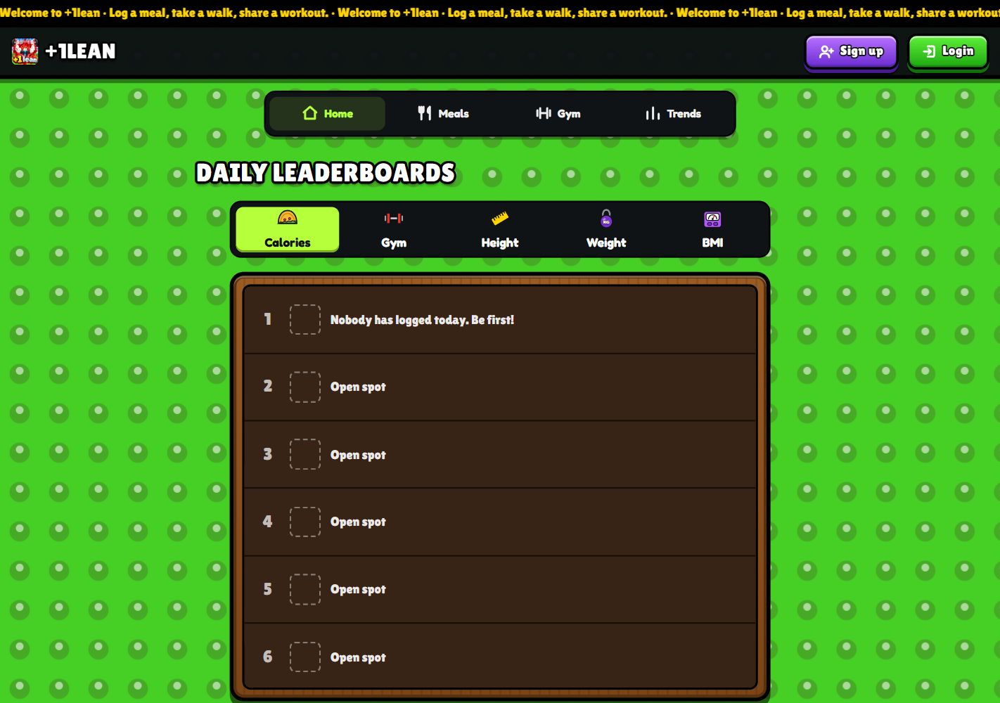
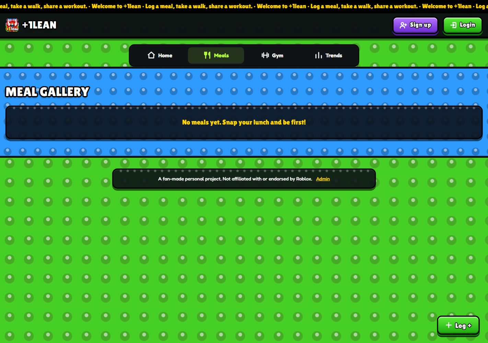
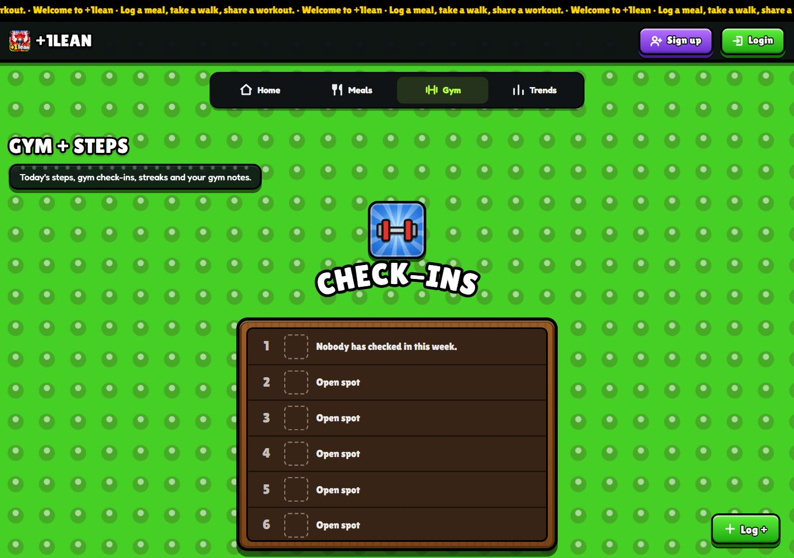
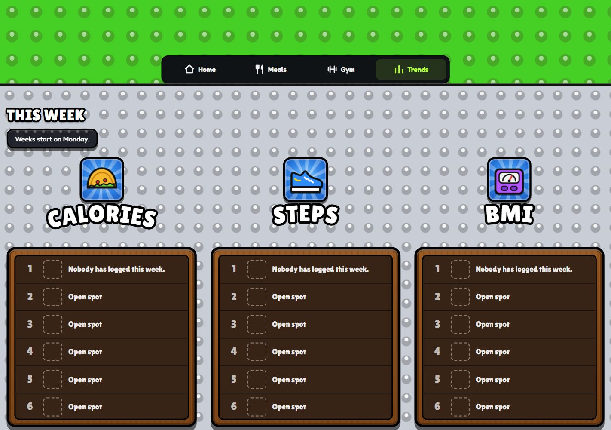

<p align="center">
  
</p>

<h1 align="center">+1lean · Roblox Wellness Site</h1>

<p align="center">Log your food. Get your steps in. Share your workout. Bring your friends.</p>

<p align="center">
  <a href="https://2026-10-17-this-website-is-called-t.vercel.app/">Open the app</a> ·
  <a href="#how-to-use-the-app">How to use it</a> ·
  <a href="#run-it-yourself">Run it yourself</a> ·
  <a href="native/README.md">iPhone &amp; Android companion</a> ·
  <a href="LICENSE">MIT license</a>
</p>

A fitness tracker for a community of friends, with bright studded backgrounds, chunky buttons, daily leaderboards and a social gym blog. Built with **Next.js, TypeScript, Tailwind CSS, Neon Postgres and Drizzle**. Works on desktop and installs on your phone's Home Screen.



> Screenshots show a clean local instance with empty states. No accounts, health records or community photos were seeded for these images. A fresh installation starts empty too.

## What makes it special

| Feature | What you can do |
| --- | --- |
| **Leaderboards with personality** | Switch between Calories, Gym, Height, Weight and BMI on Home. Find steps, gym streaks and improvement on Gym, and weekly/monthly comparisons in Trends. |
| **Photo meal journal** | Upload food, enter calories or request an optional AI estimate. **0 kcal is a valid entry.** Photos have no automatic expiry. |
| **Free reactions and comments** | Give meals a thumbs-up/down. Each card previews one comment; its arrow opens the whole thread without changing card sizes. |
| **One-stop workout logging** | Check in without proof, or save up to 20 lifts together with notes and an optional photo. All gym logging lives under one quick-log button. |
| **Streaks that allow rest days** | Visits less than 3 calendar days apart continue: Monday → Wednesday continues; Monday → Thursday resets. Each date counts once. |
| **Best lifts by weight class** | Compare exercises across nine UFC weight bands. All classes ranks strength relative to body weight; a single class compares estimated max weight. |
| **You vs everyone** | Personal weight, calorie and step charts against community averages, plus percentiles, distributions, a heatmap and a steps/calories scatter plot. |
| **An optional AI coach** | Ask “adil bot” about your own logs, goals and workouts. Manual food and step logging work without an AI provider. |
| **Phone notifications** | Opt into meals, gym, steps and weigh-ins, plus scheduled reminders and app-update alerts. Choose categories per device. |
| **A playful credit shop** | Buy ticker messages, profile/meal photo swaps or a shared app name/icon makeover. Manual revamp and crown requests go to the owner. Originals can be restored. |
| **Owner moderation** | A separate admin login manages the ticker, logs, meals, gym posts, comments, shop orders and credits, with an audit trail. |
| **Optional native step sync** | A Capacitor companion reads Apple HealthKit or Android Health Connect, including Samsung Health sharing. The browser/PWA cannot read these stores. |

## How to use the app

### 1. Join and pick your goals

Choose **Sign up** and create a username, email and password. Once signed in, the header gives you **Log**, notifications, the coach and **Shop**. Settings are at the bottom of Shop: choose kg/lb, km/mi, calorie and step goals, and a profile picture.

The phone navigation is **Home · Meals · Gym · Trends**. Home starts with Calories; tap another tab to change the board. Calories and gym activity are daily. Height stays available; weight/BMI use a recent weigh-in instead of disappearing at midnight.

### 2. Share a meal — including zero-calorie food

Choose **Log → Meal**, attach a photo and optionally add a caption. Enter a whole number from **0 to 5,000 kcal**, then save. Type **0** explicitly for a zero-calorie item. Leaving calories blank requests an AI estimate when AI is enabled; it does not mean zero. Without AI, calories are required.

Your meal appears in **Meals**. Signed-in people can vote for free, or open the comment arrow to read/post comments. The latest comment stays in one compact preview row. Photos remain until manually removed; there is no nightly cleanup.



### 3. Check in, log lifts and keep a gym blog

Choose **Log → Gym**. Save a simple check-in, or add exercise rows, weights, reps, notes and a photo together. There is no proof requirement. Pull-ups and dips accept **added** weight; blank or 0 means bodyweight. Multiple posts on one date still count as one check-in day.

Visit **Gym** for this week's check-ins, the blog, streaks, steps, improvement and best lifts. Your first visit starts a streak of 1. Keep gaps under 3 days; on the third day after your last visit, the streak has expired. Backdated logs recalculate it.



### 4. Add steps and weigh-ins, then compare trends

Use **Log → Steps** to submit a step-counter screenshot when AI is enabled, or type steps when it is disabled. For automatic phone totals, open **Connect step tracker** in the separately compiled native companion; see the [device guide](native/README.md).

Use **Log → Weigh-in** for weight, height or both. BMI is calculated from your logged height and weight. **Recent logs** lets you remove an incorrect entry.

Open **Trends** for weekly/monthly boards, then scroll to community averages, personal charts and summaries. Use the available period controls for day/week/month comparisons and 7/30/90-day community windows. Empty charts explain what needs to be logged first.



### 5. Install it and enable notifications

- **Android:** open the HTTPS site in Chrome and choose **Install app** or **Add to Home screen**.
- **iPhone:** open it in Safari, choose **Share → Add to Home Screen**, then launch that icon.
- Open the **bell → Enable notifications** and allow the permission. iPhone/iPad Web Push requires the Home Screen app on iOS/iPadOS 16.4+.
- Choose categories and use **Send test** on each device. **Maybe later** postpones the notification prompt for 24 hours.

The PWA requires an internet connection. Its service worker handles push; it does not cache private pages or provide offline logging. Native health-store access is a separate companion feature.

## Rules and calculations

| Metric | Rule |
| --- | --- |
| Calories out | Steps × calories per step; default **0.04**. Estimates step activity, not total daily energy expenditure. |
| Net calories | Calories in − estimated calories out |
| Distance in km | Steps × stride length in metres ÷ 1,000; default **0.762 m** |
| BMI | Weight in kg ÷ height in metres squared |
| Calorie ranking | Closest to the person's own daily calorie goal |
| BMI ranking | Closest to **22**; latest height plus a weigh-in from the past 90 days |
| Daily totals | Sum meals, take the highest step count, and use the latest weigh-in. Logged **0 kcal stays zero**; missing food data stays null. |
| Weekly summaries | Weeks start on Monday; summaries include averages and total steps |
| Weight classes | UFC standard limits from Strawweight **115 lb** through Heavyweight **265 lb**; upper bounds included, no extra 1 lb allowance |

Default settings are **kg, km, 2,000 kcal and 10,000 steps**. Sign-up creates only that person's settings. There are no seeded users, meals, workouts or leaderboard entries. Weight is stored in kg and converted for input/display. See [UFC's class reference](https://www.ufc.com/news/understanding-ufc-weight-classes-and-weigh-ins) and [calculation code](src/lib/calc.ts).

## Run it yourself

Tested with **Node.js 24** and npm. Create a fresh **Neon Postgres** database for your own instance.

```sh
git clone https://github.com/chonghaoooi/roblox-wellness-site.git
cd roblox-wellness-site
npm ci
```

Copy `.env.example` to `.env` (`cp .env.example .env`, or `Copy-Item .env.example .env` in PowerShell). Set `DATABASE_URL` to your Neon pooled connection string and replace `AUTH_SECRET` with a random secret of at least 32 characters. Generate it locally:

```sh
node -e "console.log(require('node:crypto').randomBytes(32).toString('base64url'))"
```

Apply the **existing** migrations, then start the app:

```sh
node --env-file=.env node_modules/drizzle-kit/bin.cjs migrate
npm run dev
```

Open `http://localhost:3000`. A fresh clone does not need migration generation. Use `npm run db:generate` only after changing the database schema. Without `DATABASE_URL`, public pages render empty states for previews; accounts and logging require the database.

### Environment variables

| Variable | Purpose |
| --- | --- |
| `DATABASE_URL` | Neon Postgres connection string with SSL |
| `AUTH_SECRET` | Private random session-signing secret, at least 32 characters |
| `APP_TIMEZONE` | Leaderboard-day timezone; example: `Asia/Singapore` |
| `AI_BASE_URL`, `AI_API_KEY`, `AI_MODEL` | Optional OpenAI-compatible API and vision-capable model; takes priority over Anthropic |
| `ANTHROPIC_API_KEY`, `ANTHROPIC_MODEL` | Optional alternative provider/model; use a model supported by your account |
| `VAPID_PUBLIC_KEY`, `VAPID_PRIVATE_KEY`, `VAPID_SUBJECT` | Optional Web Push setup; keep the private key server-only |
| `CRON_SECRET` | Authenticates Vercel reminder jobs |
| `KOFI_URL`, `KOFI_VERIFICATION_TOKEN` | Optional Ko-fi page and private webhook token for SGD credit |

Local env files, Vercel credentials, signing keys, design experiments and production screenshots are excluded from Git. This repo contains the application and migrations, not the production database.

## Deploy, moderate and customise

1. Import the repository into **Vercel** as a Next.js project.
2. Add your environment variables, using your own database and secrets.
3. Apply existing migrations to that database before serving writes, then deploy.
4. Create your separate owner login: `node --env-file=.env scripts/create-admin.mjs`.
5. Open `/admin` to manage the ticker, content, logs and shop. The script saves its generated password to your local Downloads folder; never commit that file.

For a fork, update the URLs in `capacitor.config.ts`, `scripts/configure-native-health.mjs`, `native/www/` and the admin credential note in `scripts/create-admin.mjs` before distributing your native app. No signed APKs/TestFlight builds are included.

See [operations and integrations](docs/OPERATIONS.md) for push keys, schedules, Ko-fi webhooks, shop refunds, moderation and retention. See [native builds](native/README.md) for HealthKit and Health Connect.

## Development

```sh
npm test                 # Calculation, validation, push, shop and other tests
npm run build            # Production build and TypeScript validation
npm run mobile:check     # Native health configuration checks
```

Run database checks on a development database/branch:

```sh
node --env-file=.env scripts/check-zero-calorie-meals.mjs
node --env-file=.env scripts/check-gym-streaks.mjs
node --env-file=.env scripts/check-shop-storage.mjs
```

The zero-calorie and shop checks remove transactional fixtures; streak checks use read-only inline data. No demo data is needed to run the app.

```text
src/app/          Pages, server actions, API routes and admin
src/components/   Leaderboards, forms, charts, gallery and mobile UI
src/lib/          Calculations, queries, auth, AI, push and shop rules
src/db/           Drizzle schema and Neon connection
drizzle/          Versioned SQL migrations and daily_stats view
public/           Icons, original SVG gear and service worker
native/           Optional Capacitor iOS/Android health companion
scripts/          Admin setup, assets and integration checks
docs/             Guide screenshots and operations notes
```

Contributions are welcome: explain the change, keep empty states usable, avoid seeded people/health data, and run the relevant checks before opening a pull request.

## License and credits

Project code uses the **[MIT license](LICENSE)**. Third-party packages/fonts keep their own licenses. Studded backgrounds are CSS; the SVG gear icons are original illustrations. App artwork was supplied by the project owner; see [icon sources and regeneration](docs/app-icon.md). Fonts are Lilita One and Fredoka through `next/font`.

A fan-made personal project, **not affiliated with or endorsed by Roblox or UFC**. Their names and trademarks belong to their owners.
